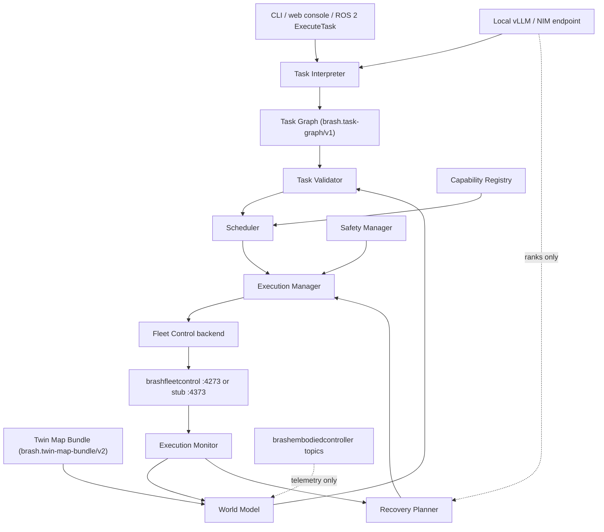

# Architecture

BrashOrchestrator turns a sentence into verified physical work. It decomposes a
natural-language goal into a typed task graph, grounds that graph against a
symbolic world model, assigns each node to the robot best suited to it, delegates
execution to Fleet Control, and refuses to call the task done until an
observation says it is.

It is deliberately not a robot controller. It sends no motor commands, holds no
vendor adapter, and owns no traffic or charging policy. Those belong to
[brashembodiedcontroller](../../brashembodiedcontroller) and
[brashfleetcontrol](../../brashfleetcontrol) respectively.

## The pipeline

```text
goal ──▶ interpret ──▶ validate ──▶ schedule ──▶ safety ──▶ execute ──▶ verify
          (LLM)        (rules)      (cost)      (policy)   (fleet)    (sensors)
```

Each stage can only narrow what the previous one allowed. The interpreter cannot
pick a robot, the scheduler cannot invent an action, and neither can overrule the
safety manager. That ordering is the whole design: it means a language model's
mistake has a bounded blast radius, because every later stage is deterministic
code that has to agree before anything moves.



## Invariants

These are the properties the system is built to hold. Most of the code exists to
enforce one of them, and each has tests named after it.

1. **A task is complete only when the goal predicate is verified by an
   observation.** Every node reporting success is not enough. A graph that ran
   perfectly but whose goal was never observed is reported as a failure with a
   specific code, never as a success. See `ExecutionManager._finalize`.
2. **The model never invents an action.** The interpreter is schema-constrained
   to the Action Library, and the recovery planner only ever asks the model to
   *rank a closed set* of options that deterministic policy already produced.
3. **The safety manager has the final veto.** It is evaluated immediately before
   every submission, reads only typed configuration and world state, and is never
   shown to the model as negotiable.
4. **Claims and observations are different facts.** The world model records
   whether a fact came from an observation or from a backend's word for it, and
   only the former counts as verified.
5. **The scheduler emits a preference, not a binding.** Fleet Control's dispatch
   keeps the final say on which robot runs the work.
6. **Failure is bounded.** Attempts per node, recovery actions per task, per-node
   timeouts, and an optional task deadline all have configured ceilings.

## Repository layout

```text
config/     robots, actions, world, scheduler weights, recovery policies, LLM, safety
schemas/    the five brash.*/vN JSON Schemas that define every contract
prompts/    interpreter and recovery system prompts, plus few-shot examples
tools/      fleet_stub: a stdlib HTTP Fleet Control stand-in with fault injection
src/        the five ROS 2 packages
tests/      unit, integration (real HTTP), simulation (scripted failures)
```

All real logic lives in pure, typed, ROS-free modules. ROS nodes are thin
wrappers. That is what lets the entire system be developed and tested with plain
`pytest` on any OS, with `colcon build` needed only for the ROS layer.

### Packages

| Package | Build | Contains |
| --- | --- | --- |
| `brash_interfaces` | ament_cmake | `ExecuteTask.action`, `RobotState.msg`, `RegisterRobot.srv`, and the rest of the ROS contract |
| `brash_orchestrator_core` | ament_python | the entire pipeline, the CLI, and one thin ROS node |
| `brash_world_model` | ament_python | predicate store, Twin bundle loader, telemetry mirror |
| `brash_safety_manager` | ament_python | policy enforcement, independent of everything above |
| `brash_bringup` | ament_cmake | launch files |

## Core modules

`src/brash_orchestrator_core/brash_orchestrator_core/`

| Module | Responsibility |
| --- | --- |
| `llm/provider.py` | `LlmProvider` protocol, OpenAI-compatible client, deterministic mock |
| `task_interpreter.py` | builds the prompt context, calls the model, repairs against validator feedback |
| `task_graph.py` | typed graph, topological sort, cycle detection, recovery-time mutation |
| `task_validator.py` | the ten checks, returning machine-readable errors the interpreter can repair |
| `capability_registry.py` | which robots can do capability X within which limits |
| `scheduler.py` | the `J(robot, action)` cost function; output is a plan, never model text |
| `execution_manager.py` | parallel DAG walk, timeouts, cancellation, dry run, recovery loop |
| `execution_monitor.py` | reconciles declared effects against observed ones, writes deltas |
| `recovery_planner.py` | deterministic policies first, model ranking second |
| `safety_manager` (own package) | zone, payload, battery, proximity, and approval rules |
| `trial_recorder.py` | one execution-grounded JSONL record per trial |
| `web/` | aiohttp operator console over the same facade — see [WEB_UI.md](WEB_UI.md) |

## Contracts

Contract IDs follow Twin Studio's `brash.<name>/vN` scheme. Everything crossing a
boundary is validated against a schema in `schemas/`, including in tests:

| Contract | Purpose |
| --- | --- |
| `brash.task-request/v1` | what an operator submits |
| `brash.task-graph/v1` | what the model must emit, enforced by constrained decoding |
| `brash.execution-event/v1` | every state change, one stream, one narrative |
| `brash.recovery-proposal/v1` | the model's ranking of a closed candidate set |
| `brash.execution-result/v1` | the terminal report for one task |

## World model

`brash_world_model` holds the symbolic state Fleet Control does not model:
objects, containers, contents, `state(box_07, closed)`, `inside(drill_01,
box_07)`. Facts carry provenance (`OBSERVATION`, `BACKEND_CLAIM`,
`SCENARIO_LOAD`, `OPERATOR`, `RECOVERY`) and only observations mark a fact
verified.

Some predicates are stored, others are derived from entity state. Asserting a new
placement retracts the stale one, so an object is never in two places at once,
and entity attributes are mirrored to match — `on(drill_01, shelf_B12)` moves the
drill's `location` as well as recording the fact.

`twin_bundle_loader.py` reads a `brash.twin-map-bundle/v2` bundle and resolves
`location_id -> MissionLocation{stationId, mapId, x, y, zoneId}`. That grounding
is what lets the validator reject a plan whose pickup and drop-off straddle two
map revisions before Fleet Control ever sees it.

## Scheduling

For every (node, robot) pair the scheduler computes

```text
J = w_time·t̂ + w_energy·Ê + w_risk·r + w_reposition·d − w_success·P(success)
```

with weights and normalizers in `config/scheduler.yaml`. Physical limits —
payload, reach, battery, capability presence — are hard eligibility filters
rather than cost terms, because no weighting should let a robot lift something it
cannot lift. The winner is passed to Fleet Control as `preferredRobotId`.

## Execution and recovery

The execution manager walks the graph in waves, running everything whose
dependencies are satisfied concurrently, so shelf inspection overlaps the carry
rather than queueing behind it. Each node gets its own timeout; the task can
carry a deadline; cancellation propagates to the fleet.

On failure the recovery planner looks up `config/recovery_policies.yaml` by error
code, filters the candidates against world state and history, and only then — if
more than one survives — asks the model to rank them. A model that names
something outside the set is ignored and the configured order stands. Recovery
strategies are `retry`, `reassign`, `insert_before`, `alternate_target`,
`escalate`, and `abort`.

The four scenarios from README section 15 are covered end to end in
`tests/simulation/test_failure_recovery.py`.

## Running it

Without ROS, against the bundled fleet stub:

```bash
python -m tools.fleet_stub --port 4373 &
python -m brash_orchestrator_core.cli --llm-profile mock --fleet-url http://127.0.0.1:4373 \
  run "Take the drill inside the closed box in the maintenance area and place it on shelf B12 on the second floor."
```

The same pipeline with a browser front end, on <http://127.0.0.1:8088>:

```bash
python -m brash_orchestrator_core.cli --llm-profile mock --fleet-url http://127.0.0.1:4373 \
  serve --port 8088
```

With ROS 2 Jazzy:

```bash
colcon build && source install/setup.bash
ros2 launch brash_bringup demo.launch.py
```

Environment variables are prefixed `ORCH_`, matching the `FLEET_` and `TWIN_`
convention of the sibling projects: `ORCH_LLM_BASE_URL`, `ORCH_LLM_MODEL`,
`ORCH_LLM_PROFILE`, `ORCH_FLEET_BASE_URL`, `ORCH_FLEET_TOKEN`, `ORCH_FLEET_SITE`,
`ORCH_DRY_RUN`, `ORCH_TRIAL_RECORDING`.

## Deviations from the reference spec

- **No `brash_robot_adapters` package.** Under fleet-delegated execution, vendor
  adapters are Fleet Control's job. The spec's `RobotAdapter` contract survives
  as the `ExecutionBackend` ABC, of which there is one implementation instead of
  one per robot, so adding a robot never touches orchestrator code.
- **The core is ROS-free and CLI-runnable**, which makes Phase 0 work without a
  ROS install and the whole system developable on Windows.
- **There is a web operator console**, which the spec does not call for. It is a
  view onto the existing facade rather than a fourth entry point with its own
  logic, and it ships with no build step so it survives a `colcon` install.
- **The recovery LLM is a ranker, not a generator**, which turns "the model must
  not invent actions" from a prompt instruction into a structural guarantee.
- **The scheduler emits a preference, not a binding**, aligning with Fleet
  Control's documented soft-preference dispatch instead of racing it.

## What this is not

The safety manager is not a safety-certified system and cannot be: it is software
in the planning path with no hardware guarantees. The certified low-level
controller, the safety scanners, and the physical emergency stop remain the
actual safety system. This layer exists so an obviously unsafe command is never
offered to them.

Every limit, tolerance, and success prior in `config/` is a structural example.
All of them must be replaced with manufacturer data, the as-built integration,
and controlled test results before any hardware run.
